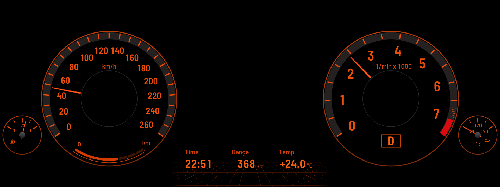

# F-Series Cluster for BMW iDrive 7 / 8 (MGU)

BMW's F-series analogue instrument cluster (F10 / F15 / F25, 2009-2018), lit in BMW orange, drawn on the digital
instrument cluster of cars with the MGU head unit through `cluster-render`.

<p align="center">
  
</p>

**Status:** checked on the Mac test bench only, not yet in a car.

## Looks

Pick one under **Theme** on the app's page in the car.

| Look | What it is |
|---|---|
| **F-series analogue (F10 / F15)** | The default. Fuel gauge, speedometer, rev counter and oil temperature gauge in closed rings, lit in BMW orange. Red-orange needles that sweep the scales once at start-up, the rev counter's hatched run-up and red block from your redline, the range bar under the speedometer, the gear in a frame, and Time, Range and Temp between the dials. |
| **F30 Comfort / Sport / Eco Pro (2017)** | The 2017 F30 / F32 digital cluster (option 6WB), one look per drive mode. Turn on "Change with SPORT / COMFORT / ECO PRO" to switch with the mode buttons. |
| **E39 M5** | Marko DEV's E39 M5 clusters (day and night), from the project this one started from. |

Speeds and temperatures follow the app's **Units** setting (km/h and °C, or mph and °F).

## Install in the car

The app installs from the MGU Store on the car, which builds it from this repository. The Store itself needs root
SSH access to the head unit; see [its guide](https://github.com/robertnisipeanu/mgu-store).

1. In the Store: Settings, then **Add source**, type `p0nyque/mgu-f-series-cluster` and pick the branch `main`.
2. Open **F-Series Cluster** and press **Install**. The car builds it, which can take a few minutes.
3. Restart the head unit if the Store asks.
4. Open the app's page under Apps and check that **Theme** is **F-series analogue (F10 / F15)**.

Never install a package built by the Mac test bench: it carries a stand-in for BMW's SDK and will not run on the car.

## Good to know

- **BMW's gear box.** The car paints a solid black box over the cluster at the rev counter's height. The rev
  counter is centred on it and both big dials have a black hub cap the box disappears into, so the big needles
  start at the cap's edge.
- **Warning lights.** The cluster is drawn opaque over BMW's own gauges. Check that BMW's warning lights and turn
  signal arrows still show before you drive with it.
- **Not shown:** fuel consumption, speed-limit signs and the odometer. The car does not send them to apps.
- **Crashes.** If the app stops unexpectedly twice, the head unit removes it; reinstall it from the Store.

## Develop

```sh
node bench/server.js f_series_cluster      # the test bench, then open http://localhost:8078
python3 design/gen_fa_layout.py            # rewrites the analogue layout
python3 design/gen_f30_layouts.py          # rewrites the three F30 layouts
```

- The dials and needles are GLSL shaders in `shared/shaders.js` (`fadash`, `faneedles`, `f30dash`, `f30needles`);
  the numbers and words are text widgets placed by the generators in `design/`. Edit the generators, not the JSON.
- Fonts are pre-baked atlases (`apps/f_series_cluster/hud/fonts`). `tools/bake_fonts.py` needs Pillow;
  `tools/bake_font_mac.swift` bakes the same format with macOS CoreText.
- The car runs Node 8.16.2: no `?.` or `??` in app code.
- More in [docs/DEVELOPING.md](docs/DEVELOPING.md) and [bench/README.md](bench/README.md); changes in
  [CHANGELOG.md](CHANGELOG.md).

## Credits

- **Marko DEV** ([markoni1408/mgu-e39-m5-cluster](https://github.com/markoni1408/mgu-e39-m5-cluster)): the E39 M5
  clusters and the project this one is forked from.
- **cauliflowermossgrape** ([idrive7-apps](https://github.com/cauliflowermossgrape/idrive7-apps)): the MGU App
  Kit (MIT).
- **Robert Nisipeanu** ([idrive-apps](https://github.com/robertnisipeanu/idrive-apps)): `cluster-render`
  (MPL-2.0), and the [MGU Store](https://github.com/robertnisipeanu/mgu-store).
- **bimmer-lab**: the cluster-render drawing engine in `shared/` (MIT).
- Fonts: Barlow, Michroma and Orbitron (SIL Open Font License 1.1).

Third-party notices: [apps/f_series_cluster/NOTICE](apps/f_series_cluster/NOTICE).

## Disclaimer

An unofficial, non-commercial fan project, not affiliated with or endorsed by BMW AG. "BMW", "iDrive" and the
model names are trademarks of BMW AG, used only to describe the look. It contains no BMW code. Use it at your own
risk: it is not approved for public roads, and the authors accept no liability for damage to the car or its
control units.

## License

MIT, see [LICENSE](LICENSE).
