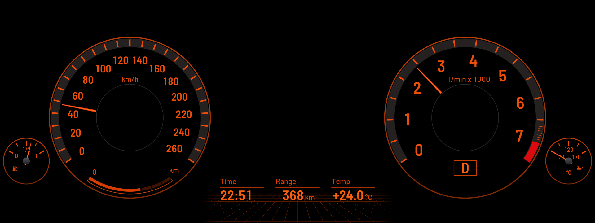

# F-Series Cluster

Instrument cluster looks for BMW iDrive 7 and 8 head units (MGU / MGU22), drawn through `cluster-render`. The
default is BMW's F-series analogue cluster, lit in BMW orange.

  

## Dashes

| Dash | Look |
|---|---|
| **F-series analogue (F10 / F15)** | The default. BMW's analogue cluster of 2009-2018, lit in BMW orange: fuel gauge, speedometer, rev counter and oil temperature gauge in closed rings, red-orange needles that sweep at start-up, the range bar under the speedometer, the gear in a frame, and Time, Range and Temp between the dials on orange hairlines. Written by `design/gen_fa_layout.py`. |
| **F30 Comfort / Sport / Eco Pro (2017)** | The 2017 F-series multifunction instrument display (option 6WB): two round dials, fuel and oil temperature gauges beside them, time and outside temperature between. One look per drive mode, picked by the mode buttons (turn on "Change with SPORT / COMFORT / ECO PRO" and pick one for each mode): Comfort black and white with red needles, Sport with a deep E-series orange flood and a large digital speed, Eco Pro in blue with the CHARGE / POWER gauge. Written by `design/gen_f30_layouts.py`. |
| **E39 M5 Cluster** | By Marko DEV. Daylight recreation of the BMW E39 M5 instrument cluster: 300 km/h speedometer and 8,000 rpm tachometer with italic numerals, oil temperature dial, coolant temperature, fuel gauge, a 5-needle start-up sweep, the Check Control display, the LED warm-up arch, the 5-segment service interval display, and a 7/8-speed Steptronic / DKG selector. |
| **E39 M5 Night Cluster** | By Marko DEV. The E39's amber night lighting, dimmed faces and red / orange needles. |

## The E39 layouts

The E39 M5 layouts come from Marko DEV's project
[markoni1408/mgu-e39-m5-cluster](https://github.com/markoni1408/mgu-e39-m5-cluster), which this app was forked
from; their start-up sequence (needle sweep, Check Control self-test, M-Power and MARKO DEV screens) and gear
display are described there. If you enjoy them, Marko DEV takes support at
[buymeacoffee.com/makiidrajf0](https://buymeacoffee.com/makiidrajf0).
